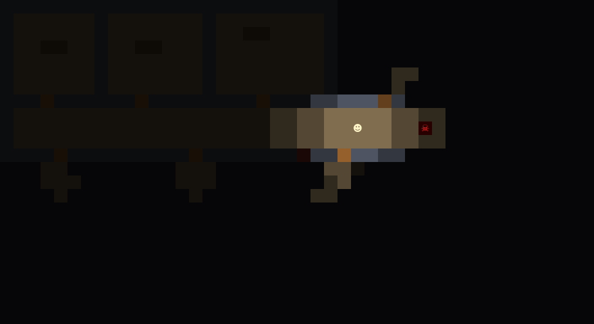

# Hora Extra

**Um jogo de terror e fuga que roda dentro do Excel. Cada casa do mapa é uma célula, a lanterna ilumina só o que está perto e alguma coisa anda pelo andar. VBA puro, sem suplementos.**



> As imagens deste README são desenhadas por `tools/testar.py` a partir do mesmo código VBA que decide a aparência de cada casa. No Excel os símbolos usam a fonte Segoe UI Symbol, então o traço muda um pouco.

Você ficou até tarde no escritório e a luz caiu. A copa está trancada, o arquivo não abre sem energia e o crachá de saída está num cofre. Depois que a luz volta, você não está mais sozinho.

## Situação

Testado em 11/10/2026 no Excel para Windows (Microsoft 365): a tela monta, as teclas respondem, a lanterna e a memória do mapa funcionam, e bilhetes e itens são lidos e coletados. No Excel foram jogados os primeiros turnos; a fuga completa, o cofre e a criatura foram conferidos pelos testes automáticos, que jogam o jogo inteiro fora do Excel.

## Como jogar

Requer Excel para Windows.

1. Crie uma pasta de trabalho e salve como `.xlsm`.
2. Aperte `Alt+F11` e importe os seis arquivos de `src/` (*Arquivo > Importar arquivo*).
3. Aperte `Alt+F8` e execute `Jogar`.

| Tecla | Ação |
| --- | --- |
| Setas ou `W` `A` `S` `D` | Andar. Esbarrar em porta, quadro de luz ou cofre interage |
| `E` | Esperar um turno |
| `R` | Recomeçar |
| `Esc` | Sair e devolver o teclado ao Excel |

Enquanto o jogo está ligado, as letras `W A S D E R` não digitam nas células. `Esc` ou trocar de aba devolve o teclado.

## O que tem no jogo

- **Turnos.** Cada passo gasta um turno e um pouco de pilha. Parado, nada acontece: dá para pensar.
- **Lanterna e escuridão.** Só aparece o que a luz alcança em linha reta. O que você já viu fica como uma sombra; o resto é preto. Sem pilha, você enxerga uma casa à frente.
- **A criatura.** Dorme até a luz voltar. Depois faz ronda, persegue quem vê e procura onde viu por último. Ela enxerga um pouco menos longe que a sua lanterna, então você a vê antes de ser visto; perseguindo, às vezes dá um bote de duas casas.
- **Esconderijos.** Entre num armário sem que ela tenha linha de visão para ele e ela passa direto.
- **Sons.** O painel avisa quando há passos longe, perto ou muito perto.
- **Enigmas encadeados.** Bilhetes, chave, fusível, quadro de luz e um cofre cujo código sai de um relatório com a fórmula quebrada (`#REF!`).

Não vou contar a solução aqui. Se travar, ela está nos comentários do início de `src/Jogo.bas`.

## Como funciona

| Módulo | Papel |
| --- | --- |
| `Texto` | Acentos escritos em ASCII e convertidos por `Ac()` |
| `Mapa` | A planta do escritório, desenhada em texto, e o que há em cada casa |
| `Jogo` | As regras: turnos, luz, enigmas e a criatura |
| `Visual` | Cor e símbolo de cada casa conforme a luz |
| `Tela` | Pinta as células e o painel |
| `Controle` | Liga o teclado às macros com `Application.OnKey` |

Quatro decisões de projeto:

- **Sem laço de jogo e sem API do Windows.** Cada tecla é ligada a uma macro com `Application.OnKey`. A macro avança um turno e redesenha. O Excel continua responsivo e o código não depende de `Declare`.
- **Só pinta o que mudou.** A tela guarda o que já está em cada célula e, a cada turno, mexe apenas nas que mudaram, em geral as que estão em volta da lanterna.
- **Luz por linha de visão.** Para cada casa no raio da lanterna, o algoritmo de Bresenham traça a reta até o jogador; parede e porta trancada barram.
- **A criatura anda por busca em largura.** O caminho mais curto até o alvo é recalculado a cada passo, então ela contorna móveis e atravessa portas abertas.

## Faça o seu andar

A planta está em `src/Mapa.bas`, uma linha de texto por fileira. A legenda fica no topo do arquivo: `#` parede, `.` piso, `+` porta, `A` armário, `k` chave, `p` pilha e assim por diante. O mapa tem 44 por 24 casas.

## Testes

Quatro dos seis módulos não dependem do Office e rodam sem alteração no modo VBA do LibreOffice Basic. O roteiro de teste joga a fuga inteira com passos automáticos e confere cada etapa (porta trancada sem chave, cofre que recusa código errado, catraca que barra sem crachá), verifica que a criatura alcança quem fica parado e que não acha quem está escondido.

```bash
python tools/testar.py            # confere e gera as imagens de docs/
python tools/testar.py --testar   # só confere (é o que o CI roda)
```

## Gravar um vídeo

`tools/Gravador.bas` é um módulo opcional: importe-o, ponha um `replay.txt` com a sequência de movimentos na pasta da planilha e execute `GravarReplay`. O Excel joga sozinho e salva uma imagem por turno na subpasta `quadros`.

## Roteiro

- Sons de verdade (passos, porta, batida do coração)
- Segundo andar, com um enigma de planilha
- Níveis de dificuldade
- Placar de menor número de turnos

## Licença

[MIT](LICENSE)
